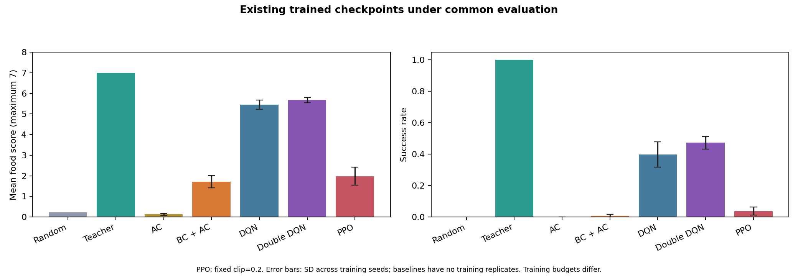
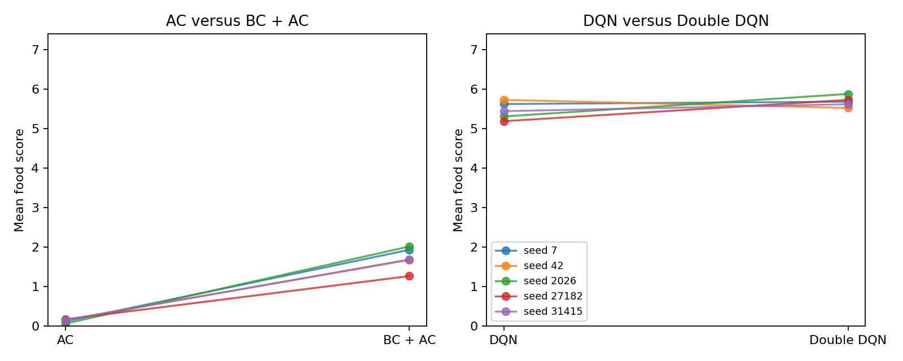
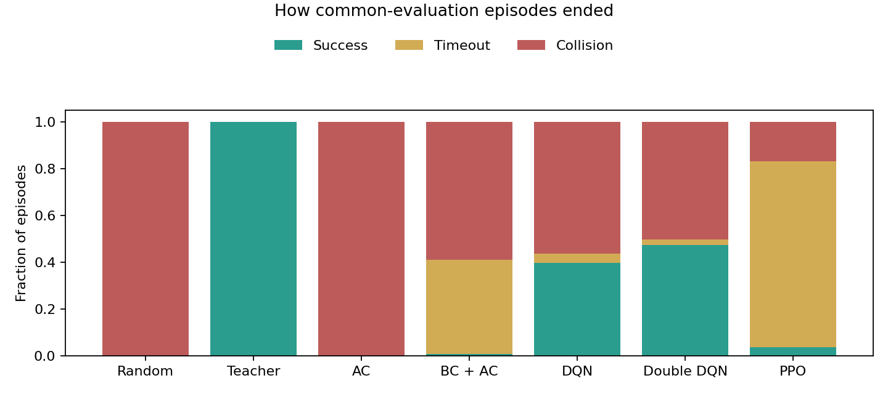
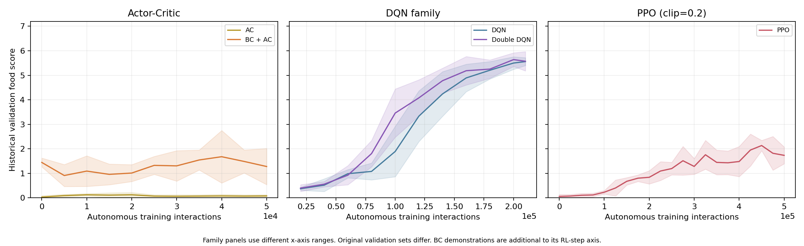
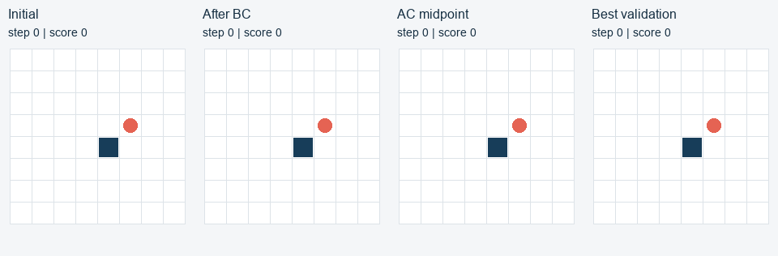
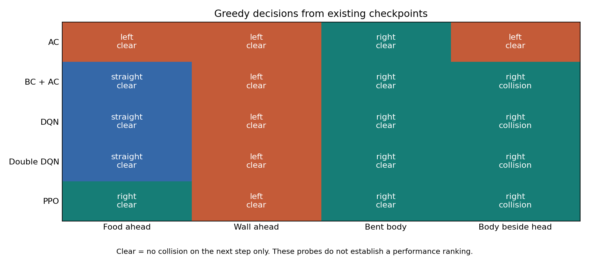

# Member 5: Common evaluation and integrated analysis

This report compares the group's delivered trained checkpoints under common game rules. It does not isolate algorithm quality under equal training resources.

## Protocol

All methods use the shared 8 x 8 environment, target length 8 (maximum food score 7), 300-step limit, sparse reward mode and relative left/right/straight actions.
Five training seeds (7, 42, 2026, 31415, 27182) and 200 common test seeds (1,200,000-1,200,199) produce 5,400 episodes, including 200 each for Random and Teacher. Learned policies use greedy argmax with no teacher takeover or safety mask.
PPO clip=0.2 was fixed before this common test. Checkpoints were selected by their original validation protocols; these test outcomes never choose a checkpoint or clip.

## Common final performance

| Method | Mean score | Seed SD | Success | Timeout | Training budget | Extra demonstrations |
|---|---:|---:|---:|---:|---:|---:|
| Random | 0.220 | N/A | 0.0% | 0.0% | 0 | 0 |
| Teacher | 7.000 | N/A | 100.0% | 0.0% | 0 | 0 |
| AC | 0.129 | 0.043 | 0.0% | 0.0% | 50,000 | 0 |
| BC + AC | 1.714 | 0.292 | 0.8% | 40.3% | 50,000 | 100 |
| DQN | 5.455 | 0.221 | 39.8% | 3.8% | 210,000 | 0 |
| Double DQN | 5.683 | 0.132 | 47.3% | 2.5% | 210,000 | 0 |
| PPO | 1.979 | 0.434 | 3.8% | 79.5% | 500,000 | 0 |

Double DQN has the highest observed learned-agent mean score (5.683) in this common evaluation. Teacher is a heuristic reference, not a mathematical upper bound.
Teacher succeeds in 100.0% of episodes, compared with 47.3% for the highest-scoring learned configuration. The learned policies have not matched the heuristic's reliability on this test batch. AC's mean score (0.129) is below Random's (0.220); training does not automatically produce useful play.
AC/BC + AC, DQN/DDQN and PPO have full autonomous training budgets of 50,000, 210,000 and 500,000 steps. BC + AC additionally uses 100 demonstration episodes. Training architectures, optimization and checkpoint-selection protocols also differ. Thus the table ranks delivered outcomes, not the intrinsic superiority of learning algorithms.
For learned methods, scores are first averaged within each trained model, then across the five training seeds. Seed SD measures training-run variability. Baselines have no independent training replicates; their episode SD is available in the common summary but is not a training-seed SD.

## Within-family improvement experiments

| Comparison | Mean score difference | Bootstrap 95% interval | Paired t p | Holm-adjusted p | Positive seeds |
|---|---:|---|---:|---:|---:|
| BC + AC minus AC | 1.585 | [1.325, 1.815] | 0.0004 | 0.0009 | 5/5 |
| Double DQN minus DQN | 0.228 | [-0.023, 0.479] | 0.1961 | 0.1961 | 4/5 |

For BC + AC minus AC, the observed mean change is 1.585; the exploratory paired t-test remains below 0.05 after Holm adjustment.

For Double DQN minus DQN, the observed mean change is 0.228; the exploratory paired t-test does not establish a difference at 0.05 after Holm adjustment.

Paired t-tests assume approximately normal seed-level differences; five seeds cannot validate that assumption well. Bootstrap intervals are descriptive and are also limited by five training replicates. Treat these comparisons as small-sample exploratory evidence. Failure to detect a difference does not establish equivalence.
BC + AC improves the mean food score but succeeds in only 0.8% of games. Demonstrations help relative to the weak AC delivery, while reliable task completion remains unresolved. Double DQN's success rate is 47.3% versus DQN's 39.8%; that success-rate difference is descriptive, not an additional significance claim.
The BC comparison includes the additional demonstration cost and measures demonstration-assisted initialization at the same autonomous budget. The DQN comparison relies on Member 3's internal training controls. Neither comparison is selected or retuned after inspecting these results.

## Episode outcomes

PPO achieves success in 3.8% of games and times out in 79.5%. Long survival by itself is not task completion; a timeout alone does not prove circling.
Collision is recorded without inventing separate wall/self-collision causes, because the common environment does not return that distinction.

## Historical learning curves

The curves below reuse the original members' validation histories; all plotted points include five training seeds. Their validation seed sets and, for PPO, validation episode counts differ. The family panels have different x-axis ranges. Use these as learning-history context; use the common final evaluation for cross-family performance comparisons. The BC + AC zero-RL-step point is after BC warm-up; demonstrations are additional to the RL-step axis.

The DQN-family validation scores rise substantially over their recorded training histories. AC remains weak, and BC + AC does not show monotonic gains after its demonstration warm-up. PPO improves after its weak early period but remains variable late in training. These descriptive patterns do not identify causal mechanisms or establish equal-budget convergence-speed differences.

## Original PPO clipping study

This separate study uses Member 4's test seeds 2,950,000-2,950,199, not the common test batch. The three clipping groups each contain five models with 500,000 training interactions per model.

| Clip | Original mean score | Seed SD | Original success |
|---|---:|---:|---:|
| 0.1 | 2.603 | 0.523 | 9.9% |
| 0.2 | 2.085 | 0.432 | 4.8% |
| 0.3 | 2.258 | 0.465 | 2.4% |

Member 4 reports descriptive seed-paired intervals that include zero for both differences against clip=0.2. These original test results do not change the common evaluation's prespecified PPO setting.

## Training-stage gameplay

The following original Member 2 animation shows Initial, After BC, AC midpoint and Best validation on game seed 900000. It illustrates BC-assisted Actor-Critic, not PPO. In this game food score changes from 0 to 1; later stages still fail to complete the task. Do not describe it as reliable mastery or monotonically improving gameplay.

## Fixed-state decision inspection

The five learned methods use their seed-42 checkpoints on the same four hand-authored 8 x 8 states. These qualitative probes compare action choices and next-step collision risk; they do not establish a population performance ranking. Actor probabilities and Q values are on different scales.

[Detailed decision report](results/decisions/20261025T095932_908221Z/report.md)

Wall ahead: AC: left (clear on the next step); BC + AC: left (clear on the next step); DQN: left (clear on the next step); Double DQN: left (clear on the next step); PPO: left (clear on the next step).

Body beside head: AC: left (clear on the next step); BC + AC: right (immediate collision); DQN: right (immediate collision); Double DQN: right (immediate collision); PPO: right (immediate collision).

A high average test score does not guarantee a sensible action on every synthetic state. The fixed probes expose local failures without retuning any model; they do not establish why those failures occur.

## Conclusions and limitations

Under the common evaluation protocol, Double DQN is the strongest delivered learned configuration by mean food score. Preserve the within-family comparisons and the training-cost disclosures when interpreting this observation.
The task is a single small board with compressed observations that omit explicit head identity, body order, visit history and remaining time. Five training seeds and one test-seed batch limit precision and generalization. No claim is made that these findings transfer to other boards or establish equal-resource algorithm superiority.
The group still needs to merge the members' full methods, this analysis and the actual contribution record into one runnable final notebook, then prepare the required human presentation. This Member 5 package is not the entire final submission.

## Contributions and AI assistance

Original group members supplied the environment, algorithms, trained weights, validation histories and gameplay animation. Member 5 integrates and evaluates those deliveries. OpenAI Codex assisted evaluation/analysis code, documentation, execution and verification. The students remain responsible for understanding and presenting their work.
