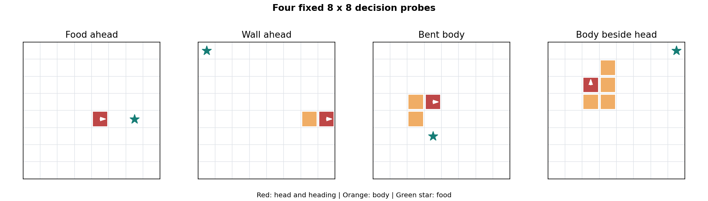
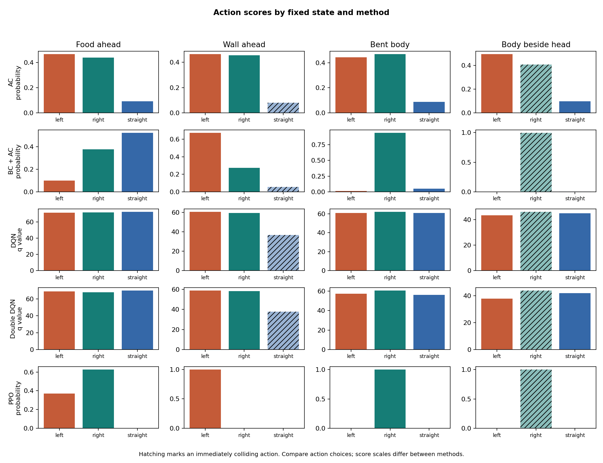

# Fixed-state decision inspection

Training seed: 42. Five existing methods, four fixed 8 x 8 states. PPO uses clip=0.2.

This is an inference-only qualitative probe. No training or full benchmark was run.

| State | Teacher reference | AC | BC + AC | DQN | Double DQN | PPO |
|---|---|---|---|---|---|---|
| Food ahead | straight | left (clear) | straight (clear) | straight (clear) | straight (clear) | right (clear) |
| Wall ahead | left | left (clear) | left (clear) | left (clear) | left (clear) | left (clear) |
| Bent body | right | right (clear) | right (clear) | right (clear) | right (clear) | right (clear) |
| Body beside head | straight | left (clear) | right (collision) | right (collision) | right (collision) | right (collision) |

Clear means only that the next move avoids collision. It does not establish long-term safety.
All methods see identical observations. Actor probabilities and Q values use different scales and must not be compared numerically across families.
These hand-authored states and one training seed cannot establish a final ranking or statistical significance.
Synthetic states have no preceding trajectory; the visit history starts at the specified head position.

The original members supplied the environment, algorithms and saved checkpoints. OpenAI Codex assisted with adapting this inspection script and checking its outputs.
