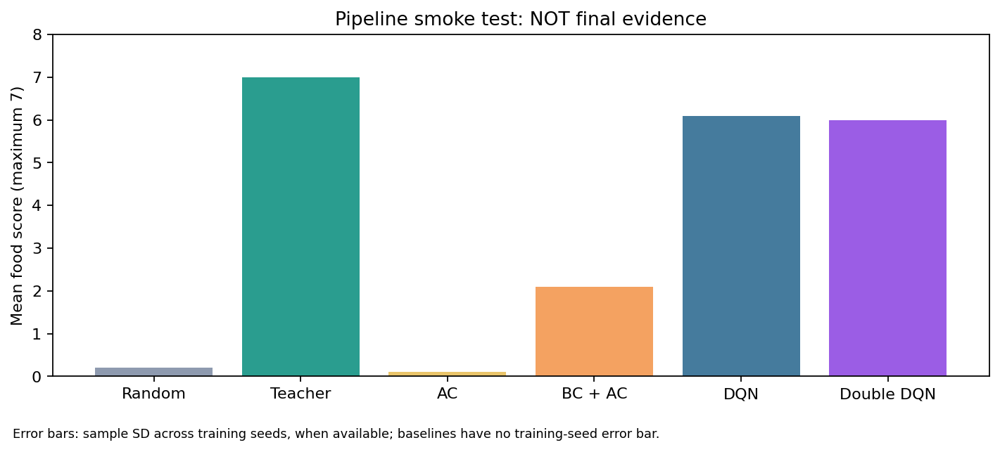

# Member 5: Unified Evaluation Run

**Status: pipeline smoke test; not evidence for a final ranking.**

Evaluation episodes per model: 10. Training seeds: [7].
Test seed range: 1100000 to 1100009.

| Method | Trained models | Mean score | Success rate | Full autonomous training budget | Extra teacher episodes |
|---|---:|---:|---:|---:|---:|
| Random | 0 | 0.200 | 0.0% | 0 | 0 |
| Teacher | 0 | 7.000 | 100.0% | 0 | 0 |
| AC | 1 | 0.100 | 0.0% | 50000 | 0 |
| BC + AC | 1 | 2.100 | 0.0% | 50000 | 100 |
| DQN | 1 | 6.100 | 50.0% | 210000 | 0 |
| Double DQN | 1 | 6.000 | 60.0% | 210000 | 0 |

For learned methods, average test episodes within each training seed before aggregating across training seeds. A single training seed cannot estimate cross-seed SD.
Random and Teacher each receive one evaluation batch and have no independent training replicates; no training-seed error bars are assigned to them.

BC + AC uses additional teacher demonstrations relative to AC. DQN/DDQN and AC have different training budgets, so the overall table compares existing trained outcomes.
The current environment does not return separate wall/self-collision causes; this version records collision without guessing the subtype.

No training was performed. Learning curves, training-stage gameplay, PPO, fixed-state decision analysis and final conclusions remain to be integrated.

Contributions: the original group authors supplied the environment, algorithm implementations and saved weights. OpenAI Codex assisted with Member 5's evaluation code, documentation and execution checks.
